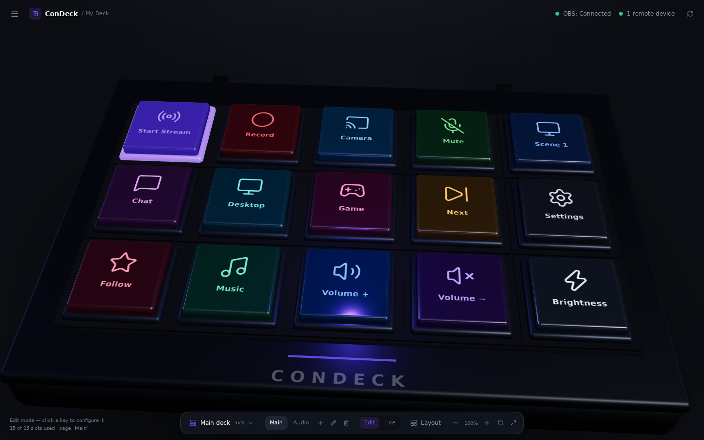
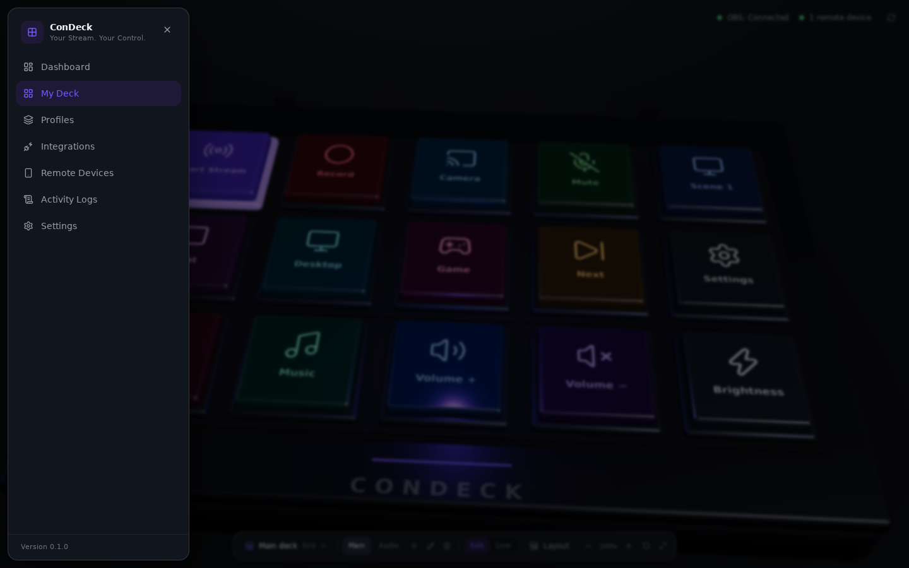
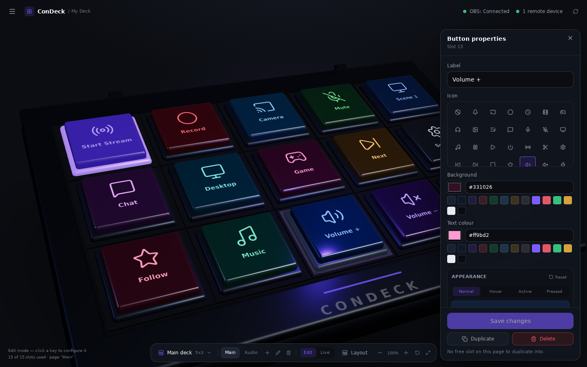
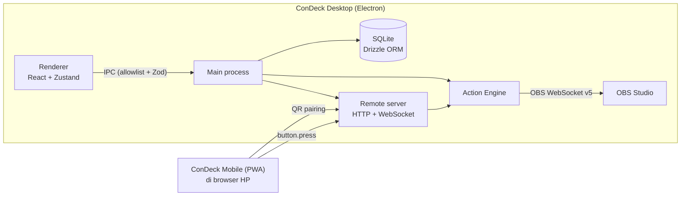

<h1 align="center">ConDeck</h1>

<p align="center">
  <strong>Your Stream. Your Control.</strong><br />
  Virtual Stream Deck untuk OBS Studio — host desktop Electron, remote di HP.
</p>

<p align="center">
  <a href="https://github.com/hafisakbar/ConDeck/actions/workflows/ci.yml"></a>
  <a href="https://github.com/hafisakbar/ConDeck/actions/workflows/release.yml"></a>
  
  
  
  
</p>

ConDeck memindahkan kontrol OBS Studio ke layar yang benar-benar bisa kamu sentuh. Aplikasi desktop menyimpan deck, menjalankan action, dan menjadi host; HP hanya membuka remote lewat browser — tanpa aplikasi tambahan, tanpa akun, tanpa cloud. Semua data tinggal di komputer kamu.

- **Bangun deck sesuai alur stream kamu.** Grid 1–8 baris/kolom, banyak halaman, tombol dengan ikon dan warna sendiri.
- **Satu tombol, satu aksi nyata.** Pindah scene, mulai/stop streaming dan recording, mute audio — dikonfirmasi oleh respons OBS, bukan asumsi sukses.
- **HP jadi remote sungguhan.** Pairing lewat QR, lalu tekan tombol dari HP dan lihat status OBS langsung berubah.

## Antarmuka



Landing page ConDeck adalah perangkat stream deck 3D yang bisa diputar, diperbesar, dan ditekan langsung. Tidak ada sidebar permanen: navigasi dibuka lewat tombol menu di kiri atas, sehingga panggung deck memakai seluruh jendela.

- **Bisa diputar seperti perangkat sungguhan.** Drag untuk memutar (kiri/kanan dan atas/bawah), scroll untuk zoom, dengan batas sudut dan jarak supaya perangkat tidak pernah hilang dari layar. Tombol **Reset view** mengembalikan sudut awal, **Fit** membingkai seluruh perangkat. Gestur sentuh ikut bekerja lewat OrbitControls.
- **Tombol berperilaku fisik.** Keycap turun saat ditekan lalu naik kembali dengan easing, dan punya tampilan berbeda untuk normal, hover, selected, pressed, active, serta disabled.
- **Warna RGB per tombol.** Setiap tombol menyimpan palette **Normal/Hover/Active/Pressed** sendiri: warna latar, teks/ikon, garis tepi, warna glow, dan intensitas glow. Panel properti punya color picker + input HEX, pratinjau langsung di perangkat 3D, dan reset per state. Perubahan disimpan ke database dan tetap ada setelah aplikasi dibuka lagi, terpisah untuk setiap profil.
- **Active mengikuti OBS, bukan klik terakhir.** Tombol streaming/recording menyala hanya ketika OBS benar-benar streaming/recording, tombol scene menyala saat scene itu aktif, dan tombol mute menyala sesuai status mute input di OBS. Saat OBS terputus, semua status aktif padam.
- **Dua mode yang jelas.** `Edit` untuk memilih dan mengonfigurasi tombol; `Live` untuk menjalankan action. Panel properti otomatis tertutup saat masuk Live.
- **Klik untuk mengonfigurasi.** Klik keycap (atau slot kosong) untuk membuka panel properti mengambang berisi label, ikon, warna, posisi, dan action. Tidak ada panel yang selalu memakan ruang.
- **Grid fleksibel.** Baris/kolom (1–8) disimpan di database bersama deck. Ukuran tombol, jarak, dan zoom disimpan sebagai preferensi lokal, plus tombol **Fit**. Mengecilkan grid yang masih berisi tombol meminta konfirmasi karena slot tersebut akan dihapus.
- **Tetap ringan.** Setiap keycap adalah mesh individual dengan tekstur canvas (label + ikon Lucide), bukan 64 elemen DOM. Scene three.js dimuat terpisah (lazy) dan diganti fallback grid 2D bila WebGL tidak tersedia.

Tombol menu membuka drawer berisi seluruh halaman lama — Dashboard, My Deck, Profiles, Integrations, Remote Devices, Activity Logs, Settings — jadi tidak ada fitur yang hilang.





Perubahan warna disimpan di kolom `buttons.appearance_json` (migrasi `0001_button_appearance`). Data lama tetap valid: tombol tanpa palette memakai warna latar/teks lamanya sebagai default, jadi tidak ada reset database.

## Arsitektur



Renderer tidak pernah menyentuh Node.js, SQLite, atau OBS secara langsung. HP tidak punya akses database dan hanya boleh mengirim pesan yang sudah ditentukan kontraknya. Detail kontrak ada di [`files/TECHNICAL_SPECIFICATION.md`](files/TECHNICAL_SPECIFICATION.md) dan [`files/API_WEBSOCKET_CONTRACT.md`](files/API_WEBSOCKET_CONTRACT.md).

## Yang sudah berjalan (Phase 1–6)

| Area               | Kemampuan                                                                                                                                                |
| ------------------ | -------------------------------------------------------------------------------------------------------------------------------------------------------- |
| **Deck builder**   | Buat/ganti nama/ubah ukuran/hapus deck (default 3 × 3, preset 4 × 4, 5 × 3, 5 × 5, custom 1–8), kelola halaman, tambah tombol, atur label/ikon/warna/aktif. |
| **Tombol**         | Pindahkan ke slot lain, gandakan ke slot kosong berikutnya, hapus; posisi halaman dirapikan otomatis setelah penghapusan.                                |
| **Profil**         | Edit dan hapus profil beserta seluruh deck, halaman, dan tombol di dalamnya.                                                                             |
| **Action**         | 11 action: 7 untuk OBS, 2 System (buka aplikasi, buka URL), 2 Navigation (halaman berikutnya/sebelumnya). Satu action per tombol.                        |
| **Eksekusi**       | Validasi schema per action sebelum disimpan, eksekusi lewat registry berdasarkan button id, timeout 10 detik, feedback sukses/gagal langsung di tombol.   |
| **OBS**            | Koneksi OBS WebSocket v5, test connection, connect/disconnect, daftar scene otomatis, sinkronisasi status real-time saat OBS diubah dari luar ConDeck.    |
| **Remote**         | Server LAN (default port `43821`), QR pairing 2 menit sekali pakai (5 percobaan), kredensial perangkat 32 byte, cabut akses, reconnect otomatis.          |
| **Remote di HP**   | Deck aktif tampil apa adanya, `button.press` menjalankan action yang sama, status OBS dan hasil action ikut tampil, deck yang diubah langsung dikirim ulang. |
| **Penyimpanan**    | Semua perubahan langsung tersimpan ke SQLite lokal dan tetap ada setelah aplikasi ditutup.                                                                |

Halaman yang fiturnya belum masuk phase terkait menampilkan keterangan eksplisit, bukan data palsu.

## Prasyarat

- **Windows 10/11 64-bit** — target rilis. Typecheck, test, dan build renderer bisa dijalankan di Linux/macOS, tetapi aplikasi Electron belum diuji di luar Windows.
- **Node.js ≥ 20.19** dan **pnpm 10.20** (`corepack enable`)
- **OBS Studio 28+** dengan WebSocket server aktif (Tools → WebSocket Server Settings)

## Mulai cepat

```bash
pnpm install
pnpm --filter @condeck/desktop rebuild:native   # better-sqlite3 untuk ABI Electron (sekali per instalasi)
pnpm dev
```

`pnpm dev` membangun main + preload, menjalankan Vite dev server (port 5273), lalu membuka Electron.

Setelah jendela terbuka:

1. **My Deck** — buat deck, klik keycap untuk menambah/mengubah tombol dan action, lalu pindah ke **Live** untuk menguji tekanannya.
2. **Integrations** — isi host/port/password OBS WebSocket, klik **Connect**. Daftar scene langsung muncul di editor action.
3. **Devices** — nyalakan server remote, lalu pindai QR dari HP yang berada di Wi-Fi yang sama.

Untuk mengembangkan tampilan remote saja: `pnpm dev:mobile` (Vite, port 5274), lalu isi alamat desktop dan pairing code secara manual.

## Installer Windows

```bash
pnpm dist:win
```

Menghasilkan installer NSIS di `release/`:

- `ConDeck-0.1.0-x64.exe` — installer (pilih folder instalasi, shortcut Desktop + Start Menu, tanpa hak admin).
- `win-unpacked/` — versi portable untuk pemeriksaan cepat.

Isi paket: renderer di `app.asar`, main/preload Electron, PWA di `resources/mobile`, dan `better-sqlite3` yang sudah di-rebuild. Ingin memeriksa isi paket tanpa membuat installer? Jalankan `pnpm --filter @condeck/desktop dist:dir`.

Installer juga dibangun otomatis di GitHub Actions (`release.yml`, `windows-latest`) lewat **Run workflow** atau saat push tag `v*`. Installer belum ditandatangani, jadi SmartScreen akan menampilkan “Windows protected your PC” — pilih **More info → Run anyway** hanya untuk build yang kamu percaya. Langkah lengkap ada di [`docs/RELEASE.md`](docs/RELEASE.md).

## Perintah

| Perintah           | Fungsi                                                                    |
| ------------------ | ------------------------------------------------------------------------- |
| `pnpm dev`         | Jalankan ConDeck Desktop (development)                                    |
| `pnpm dev:mobile`  | Jalankan ConDeck Mobile (Vite, port 5274) untuk pengembangan UI remote    |
| `pnpm build`       | Build produksi desktop (main, preload, renderer) + PWA mobile             |
| `pnpm typecheck`   | TypeScript check seluruh workspace                                        |
| `pnpm lint`        | ESLint                                                                    |
| `pnpm test`        | Vitest: unit + integration (tanpa GUI)                                    |
| `pnpm test:watch`  | Vitest mode watch                                                         |
| `pnpm test:e2e`    | Build PWA, lalu E2E Playwright terhadap server remote dan SQLite sungguhan |
| `pnpm dist:win`    | Installer Windows (NSIS) di `release/`                                    |
| `pnpm db:generate` | Generate migrasi SQL Drizzle setelah mengubah `schema.ts`                 |

Untuk E2E di mesin baru, unduh browser sekali: `pnpm exec playwright install --with-deps chromium`.

## Remote di HP

1. `pnpm build` (PWA ikut dibangun) lalu jalankan desktop.
2. Buka **Devices**, tentukan port, nyalakan server remote.
3. Pindai QR dari HP di Wi-Fi yang sama. Bila kamera tidak membuka tautannya, buka alamat yang tertulis dan tempel pairing code manual.
4. Setelah dipasangkan, HP mengingat kredensialnya dan menyambung ulang sendiri setiap kali halaman dibuka.

Yang perlu diketahui:

- Alamat di QR adalah alamat LAN terbaik (Wi-Fi/Ethernet diutamakan). Adapter virtual seperti VirtualBox, Hyper-V, WSL, atau VPN ikut terdaftar tetapi tidak bisa dijangkau HP — coba alamat berikutnya bila yang pertama timeout.
- Remote memakai HTTP biasa di LAN. Service worker dan prompt “Install app” memerlukan HTTPS; tanpa itu halaman tetap berfungsi selama server desktop hidup, dan “Add to Home Screen” di iOS masih bisa, hanya mode offline yang tidak.
- Mencabut perangkat dari desktop langsung memutus koneksinya; HP berhenti mencoba dan diminta pairing ulang.

## Keamanan

- `contextIsolation: true`, `nodeIntegration: false`, `sandbox: true`, `webSecurity: true`; renderer tanpa akses Node.js maupun SQLite.
- IPC memakai allowlist channel (`packages/shared/src/ipc.ts`) dan validasi Zod di main process; bridge preload hanya mengekspos objek `condeck`.
- Action hanya berjalan lewat registry (`packages/action-engine`), konfigurasi diparse ulang sebelum eksekusi, satu eksekusi per tombol, timeout 10 detik.
- Action System memakai `shell.openPath`/`shell.openExternal` tanpa shell, hanya menerima path absolut dan URL http(s); navigasi dan `window.open` dibatasi, `webview` diblokir.
- CSP ketat disuntikkan ke HTML hasil build; respons remote memakai CSP sendiri (`connect-src 'self' ws: wss:`).
- Password OBS tidak pernah plaintext: disimpan lewat Electron `safeStorage` sebagai ciphertext. Sistem tanpa credential store aman ditolak saat menyimpan password.
- Logger meredaksi `password`, `secret`, `token`, `credential`, dan `hash`.
- Remote hanya menerima pesan yang lolos schema Zod (maks. 8 KB) setelah perangkat terautentikasi — tidak ada channel untuk shell atau perintah bebas.
- Pairing code disimpan di memori (bukan database), berumur 2 menit, sekali pakai, hangus setelah 5 percobaan.
- Kredensial perangkat dikirim sekali saat pairing; database menyimpan hash SHA-256 dan verifikasi memakai `timingSafeEqual`.

## Data & migrasi

- Database: `<userData>/condeck.db` — di Windows berada di bawah `%APPDATA%` aplikasi Electron.
- Log: `<userData>/logs/condeck.log`.
- Pragmas: `foreign_keys = ON`, `journal_mode = WAL`.
- Schema: `packages/database/src/schema.ts` (10 tabel sesuai `files/DATABASE_DESIGN.md`).
- Migrasi di-generate Drizzle Kit ke `packages/database/drizzle`, dibundel sebagai raw SQL, dan diterapkan otomatis saat aplikasi start dengan pencatatan di `__condeck_migrations` (idempoten — upgrade tidak menghapus data).

Menambah perubahan schema: ubah `schema.ts` → `pnpm db:generate` → daftarkan file SQL baru di `packages/database/src/migrate.ts`.

## Pengujian

| Lapisan            | Cakupan                                                                                                              |
| ------------------ | -------------------------------------------------------------------------------------------------------------------- |
| Unit + integration | 238 test / 24 file — repository & migrasi database, action registry, klien OBS, remote server, protokol, UI mobile, geometri grid 3D, dan status aktif tombol. |
| E2E                | Playwright (Chromium) menjalankan **PWA hasil build** ke server remote + SQLite sungguhan: CSP/aset, pairing QR, render deck, tekan tombol sampai feedback sukses, pairing code salah. |
| Keamanan           | Preload hanya mengekspos `condeck`; seluruh channel yang dipakai ada di allowlist IPC.                               |
| CI                 | Setiap PR & push ke `main`: typecheck → lint → unit/integration → build → E2E.                                       |

Yang belum tercakup otomatis: UI Electron end-to-end (butuh runner GUI/Windows), instalasi pada mesin Windows fisik, dan benchmark performa berkelanjutan.

Untuk pratinjau tampilan tanpa membuka Electron, harness di `scripts/preview` menyajikan hasil build renderer dengan bridge tiruan lalu memotretnya:

```bash
pnpm --filter @condeck/desktop build
node scripts/preview/capture.mjs   # menulis docs/screenshots/*.png
```

Harness ini hanya alat review. Ia tidak memakai database, OBS, maupun IPC sungguhan, jadi bukan pengganti pengujian aplikasi Electron.

## Struktur

```text
condeck/
├── apps/
│   ├── desktop/
│   │   ├── electron/
│   │   │   ├── main/          # lifecycle, window, IPC, services (database, remote, dashboard)
│   │   │   └── preload/       # contextBridge — satu-satunya jembatan ke renderer
│   │   ├── src/
│   │   │   ├── components/    # layout, ui, activity, dashboard, profiles, deck, stream-deck (3D)
│   │   │   ├── pages/         # Dashboard, My Deck (3D), Profiles, Integrations, Devices, Activity, Settings
│   │   │   ├── stores/        # Zustand
│   │   │   └── lib/           # bridge, format, navigasi
│   │   ├── build/             # ikon aplikasi
│   │   ├── electron-builder.yml
│   │   └── scripts/dev.mjs    # dev runner
│   └── mobile/                # PWA remote (Vite + React, disajikan server desktop)
├── packages/
│   ├── config/                # tsconfig base
│   ├── shared/                # tipe + schema Zod + kontrak IPC
│   ├── action-engine/         # registry, port, executor action
│   ├── obs-integration/       # klien OBS WebSocket v5 + sinkronisasi status
│   ├── websocket-protocol/    # kontrak pesan remote (Zod, envelope, close code)
│   └── database/              # schema Drizzle, migrasi, repository
├── e2e/                       # Playwright di dalam Vitest
├── scripts/preview/           # harness screenshot renderer (mock bridge + Playwright)
├── files/                     # PRD, spesifikasi teknis, kontrak, roadmap
├── docs/                      # DECISIONS.md, RELEASE.md
├── .github/workflows/         # ci.yml, release.yml
└── pnpm-workspace.yaml
```

## Troubleshooting

| Gejala                                         | Penyebab & solusi                                                                                                                     |
| ---------------------------------------------- | ------------------------------------------------------------------------------------------------------------------------------------- |
| HP: “Situs ini tidak bisa dijangkau” / timeout  | Firewall Windows memblokir port remote (izinkan di profil **Private**), Wi-Fi memakai client/AP isolation, atau alamat yang dipakai milik adapter virtual. |
| QR terbuka, pairing gagal                      | Code berumur 2 menit dan hangus setelah 5 percobaan — buat code baru dari halaman **Devices**.                                        |
| OBS gagal connect                              | Pastikan WebSocket server aktif di OBS 28+, port benar (default `4455`), dan password sama; cek pesan error di halaman Integrations.  |
| `NODE_MODULE_VERSION` mismatch setelah install | Native module belum cocok dengan Electron: `pnpm --filter @condeck/desktop rebuild:native`.                                            |
| Port remote tidak bisa dipakai                 | Port sedang dipakai proses lain — ganti port di halaman **Devices** lalu nyalakan ulang.                                               |
| `pnpm test:e2e` gagal: browser tidak ditemukan | `pnpm exec playwright install --with-deps chromium`.                                                                                   |
| Tombol di HP tidak bereaksi                    | Lihat halaman **Activity** di desktop: setiap eksekusi dan kegagalannya tercatat.                                                      |

## Status & roadmap

| Phase                 | Cakupan                                                                                       | Status     |
| --------------------- | --------------------------------------------------------------------------------------------- | ---------- |
| 1 — Foundation        | Monorepo, Electron, React, Tailwind, SQLite + Drizzle, preload aman, IPC, dashboard, navigasi | ✅ Selesai |
| 2 — Deck Builder      | Deck, page, button grid, button editor, ikon & warna, profil                                  | ✅ Selesai |
| 3 — Action Engine     | Registry action, validasi, eksekusi, feedback                                                 | ✅ Selesai |
| 4 — OBS Integration   | OBS WebSocket v5, scene/stream/record/audio                                                   | ✅ Selesai |
| 5 — Mobile Remote     | PWA, WebSocket server, QR pairing, device auth                                                | ✅ Selesai |
| 6 — Testing & Release | E2E, migration & security tests, installer Windows, dokumentasi rilis                          | ✅ Selesai |

Rencana dan kriteria tiap phase ada di [`files/DEVELOPMENT_ROADMAP.md`](files/DEVELOPMENT_ROADMAP.md).

## Dokumentasi

- [`files/PRD.md`](files/PRD.md) — tujuan produk, persona, dan kebutuhan fitur.
- [`files/TECHNICAL_SPECIFICATION.md`](files/TECHNICAL_SPECIFICATION.md) — arsitektur, proses, dan batas modul.
- [`files/API_WEBSOCKET_CONTRACT.md`](files/API_WEBSOCKET_CONTRACT.md) — kontrak pesan remote dan kode penutupan.
- [`files/DATABASE_DESIGN.md`](files/DATABASE_DESIGN.md) — skema dan alasan di balik tabel.
- [`files/UI_UX_SPECIFICATION.md`](files/UI_UX_SPECIFICATION.md) — tata letak dan perilaku antarmuka.
- [`docs/DECISIONS.md`](docs/DECISIONS.md) — ADR, keputusan implementasi, dan resolusi konflik antar-dokumen.
- [`docs/RELEASE.md`](docs/RELEASE.md) — build installer, instalasi, upgrade, dan checklist rilis.

## Catatan pengembangan

- `pnpm dev` membangun main/preload sekali. Setelah mengubah `apps/desktop/electron/**`, hentikan dan jalankan ulang.
- Renderer memakai HMR normal dari Vite.
- Perubahan dikerjakan di branch sendiri dan masuk lewat pull request; CI menjalankan pemeriksaan yang sama seperti di lokal.

## Lisensi

Belum ada lisensi publik untuk proyek ini — semua hak dipegang pemilik repositori. Hubungi pemilik sebelum menggunakan kode ini di luar keperluan pribadi.
