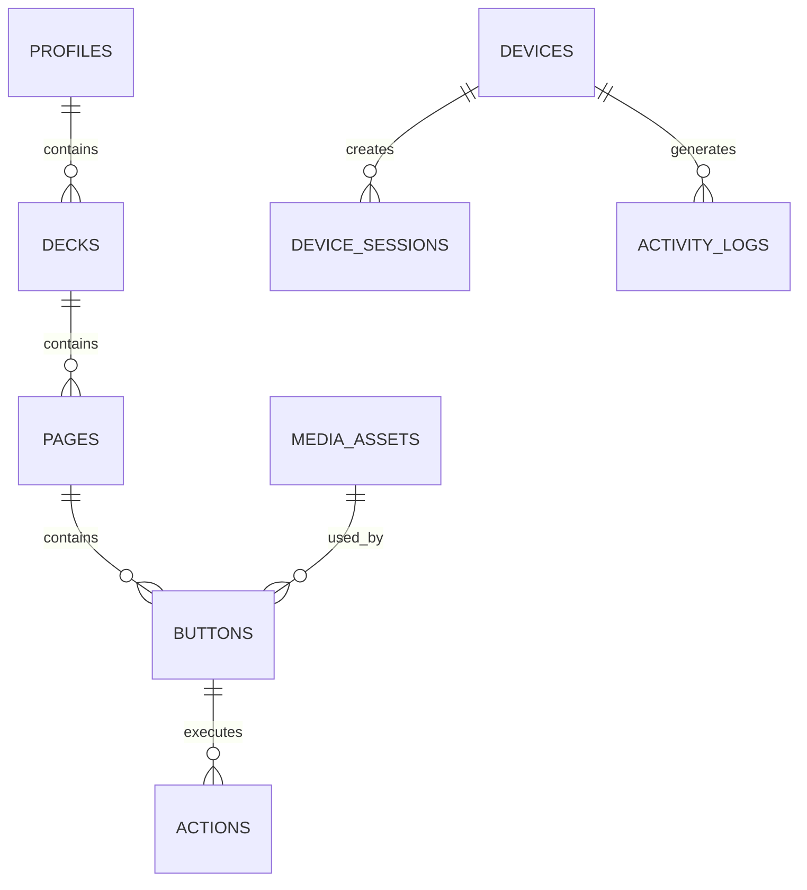

# ConDeck — Database Design

**Version:** 1.0  
**Document Type:** Database Specification  
**Database:** SQLite  
**ORM:** Drizzle ORM

## 1. Overview

ConDeck menggunakan SQLite sebagai database lokal untuk menyimpan konfigurasi aplikasi.

Database berada di Desktop Application dan tidak diakses langsung oleh Mobile.

Seluruh perubahan konfigurasi dilakukan melalui Desktop dan disinkronkan ke Mobile menggunakan WebSocket.

## 2. Database Principles

- Local-first.
- Tidak memerlukan cloud database.
- Data tetap tersedia setelah aplikasi ditutup.
- Gunakan foreign key.
- Gunakan migration untuk perubahan struktur.
- Validasi data sebelum disimpan.
- Gunakan transaction untuk operasi yang melibatkan beberapa tabel.
- Gunakan UUID untuk primary key.
- Simpan timestamp dalam format UTC ISO 8601 atau integer Unix secara konsisten.

## 3. Database Entities

Database terdiri dari entitas utama berikut:

1. `profiles`
2. `decks`
3. `pages`
4. `buttons`
5. `actions`
6. `integrations`
7. `devices`
8. `device_sessions`
9. `media_assets`
10. `activity_logs`

## 4. Table Specifications

### 4.1 profiles

Menyimpan profil konfigurasi pengguna.

| Field | Type | Description |
|---|---|---|
| id | TEXT | Primary key |
| name | TEXT | Nama profil |
| description | TEXT | Deskripsi |
| is_active | INTEGER | Status aktif |
| created_at | TEXT | Waktu dibuat |
| updated_at | TEXT | Waktu diperbarui |

### 4.2 decks

Menyimpan konfigurasi deck.

| Field | Type | Description |
|---|---|---|
| id | TEXT | Primary key |
| profile_id | TEXT | Foreign key ke profiles |
| name | TEXT | Nama deck |
| columns | INTEGER | Jumlah kolom |
| rows | INTEGER | Jumlah baris |
| created_at | TEXT | Waktu dibuat |
| updated_at | TEXT | Waktu diperbarui |

### 4.3 pages

Menyimpan halaman dalam deck.

| Field | Type | Description |
|---|---|---|
| id | TEXT | Primary key |
| deck_id | TEXT | Foreign key ke decks |
| name | TEXT | Nama halaman |
| position | INTEGER | Urutan halaman |
| created_at | TEXT | Waktu dibuat |
| updated_at | TEXT | Waktu diperbarui |

### 4.4 buttons

Menyimpan konfigurasi tombol.

| Field | Type | Description |
|---|---|---|
| id | TEXT | Primary key |
| page_id | TEXT | Foreign key ke pages |
| position | INTEGER | Posisi tombol |
| label | TEXT | Teks tombol |
| icon | TEXT | Icon identifier |
| image_asset_id | TEXT | Referensi media |
| background_color | TEXT | Warna background |
| text_color | TEXT | Warna teks |
| is_enabled | INTEGER | Status tombol |
| created_at | TEXT | Waktu dibuat |
| updated_at | TEXT | Waktu diperbarui |

### 4.5 actions

Menyimpan konfigurasi action setiap tombol.

| Field | Type | Description |
|---|---|---|
| id | TEXT | Primary key |
| button_id | TEXT | Foreign key ke buttons |
| action_type | TEXT | Jenis action |
| config_json | TEXT | Konfigurasi action |
| position | INTEGER | Urutan action |
| created_at | TEXT | Waktu dibuat |
| updated_at | TEXT | Waktu diperbarui |

`config_json` harus divalidasi berdasarkan schema action type yang bersangkutan.

### 4.6 integrations

Menyimpan konfigurasi integrasi eksternal.

| Field | Type | Description |
|---|---|---|
| id | TEXT | Primary key |
| provider | TEXT | Nama provider |
| display_name | TEXT | Nama tampilan |
| host | TEXT | Host atau alamat server |
| port | INTEGER | Port koneksi |
| credential_reference | TEXT | Referensi kredensial aman |
| is_enabled | INTEGER | Status integrasi |
| created_at | TEXT | Waktu dibuat |
| updated_at | TEXT | Waktu diperbarui |

Password dan secret tidak boleh disimpan langsung sebagai plaintext di tabel ini.

### 4.7 devices

Menyimpan perangkat Mobile yang telah dipasangkan.

| Field | Type | Description |
|---|---|---|
| id | TEXT | Primary key |
| device_name | TEXT | Nama perangkat |
| device_type | TEXT | Jenis perangkat |
| credential_hash | TEXT | Hash kredensial perangkat |
| last_seen_at | TEXT | Terakhir aktif |
| is_authorized | INTEGER | Status otorisasi |
| created_at | TEXT | Waktu pairing |

### 4.8 device_sessions

Menyimpan sesi perangkat yang sedang terhubung.

| Field | Type | Description |
|---|---|---|
| id | TEXT | Primary key |
| device_id | TEXT | Foreign key ke devices |
| session_status | TEXT | Status sesi |
| connected_at | TEXT | Waktu terhubung |
| disconnected_at | TEXT | Waktu terputus |
| last_activity_at | TEXT | Aktivitas terakhir |

Sesi harus dapat berakhir ketika perangkat dicabut aksesnya.

### 4.9 media_assets

Menyimpan metadata file gambar dan aset visual.

| Field | Type | Description |
|---|---|---|
| id | TEXT | Primary key |
| file_name | TEXT | Nama file |
| file_path | TEXT | Lokasi file lokal |
| mime_type | TEXT | Format file |
| file_size | INTEGER | Ukuran file |
| created_at | TEXT | Waktu dibuat |

File media disimpan di penyimpanan lokal, sedangkan database hanya menyimpan metadata dan lokasi file.

### 4.10 activity_logs

Menyimpan riwayat aktivitas penting.

| Field | Type | Description |
|---|---|---|
| id | TEXT | Primary key |
| device_id | TEXT | Perangkat terkait, nullable |
| event_type | TEXT | Jenis aktivitas |
| description | TEXT | Deskripsi |
| metadata_json | TEXT | Informasi tambahan |
| created_at | TEXT | Waktu aktivitas |

## 5. Relationships

- Satu profile dapat memiliki beberapa deck.
- Satu deck memiliki beberapa page.
- Satu page memiliki beberapa button.
- Satu button dapat memiliki beberapa action.
- Satu button dapat menggunakan media asset.
- Integrasi disimpan terpisah dari action.
- Satu device dapat memiliki beberapa session.
- Activity log dapat berhubungan dengan device.

## 6. Relationship Diagram

## 7. Data Validation

Setiap tabel harus memiliki validasi.

Contoh:

- Nama profile tidak boleh kosong.
- Nama deck tidak boleh kosong.
- Jumlah baris dan kolom harus lebih besar dari nol.
- Posisi tombol harus berada dalam batas grid.
- Setiap action harus memiliki action type yang valid.
- Konfigurasi action harus sesuai dengan schema.
- Kredensial perangkat harus memiliki format yang valid.
- Referensi file harus menunjuk ke aset yang tersedia.

## 8. Database Constraints

Implementasikan:

- Primary key.
- Foreign key.
- Unique constraints untuk posisi halaman dalam deck.
- Unique constraints untuk posisi tombol dalam halaman.
- Index pada foreign key.
- Cascade delete untuk data turunan yang memang tidak lagi diperlukan.
- Transaction untuk operasi yang mengubah beberapa entitas.

Perhatikan bahwa penghapusan profile, deck, atau page harus ditangani secara konsisten agar tidak meninggalkan data yatim.

## 9. Database Migration

Gunakan Drizzle ORM untuk:

- Mendefinisikan schema.
- Membuat migration.
- Menjalankan migration saat aplikasi diperbarui.
- Menjaga kompatibilitas data pengguna.

Jangan mengubah database pengguna secara manual tanpa migration.

## 10. Storage Security

- Database hanya dikelola Desktop.
- Mobile tidak memiliki akses SQLite.
- Jangan menyimpan password OBS secara plaintext.
- Gunakan Electron safeStorage untuk melindungi kredensial.
- Simpan file media dalam direktori aplikasi yang sesuai.
- Jangan menyimpan file sementara secara permanen tanpa kebutuhan.

## 11. Acceptance Criteria

Database dianggap siap apabila:

- Seluruh entitas utama berhasil dibuat.
- Relasi antarentitas berfungsi.
- Konfigurasi deck dapat disimpan dan dimuat kembali.
- Action dapat dihubungkan dengan tombol.
- Perangkat dapat diregistrasikan.
- Sesi perangkat dapat dikelola.
- Data tetap tersedia setelah restart.
- Migration dapat dijalankan tanpa merusak data.
- Penghapusan data tidak meninggalkan relasi yang tidak valid.

**Catatan:** Dokumen ini menjadi acuan implementasi database ConDeck. Jika ada perubahan struktur, perbarui schema, migration, dan dokumen ini secara bersamaan.